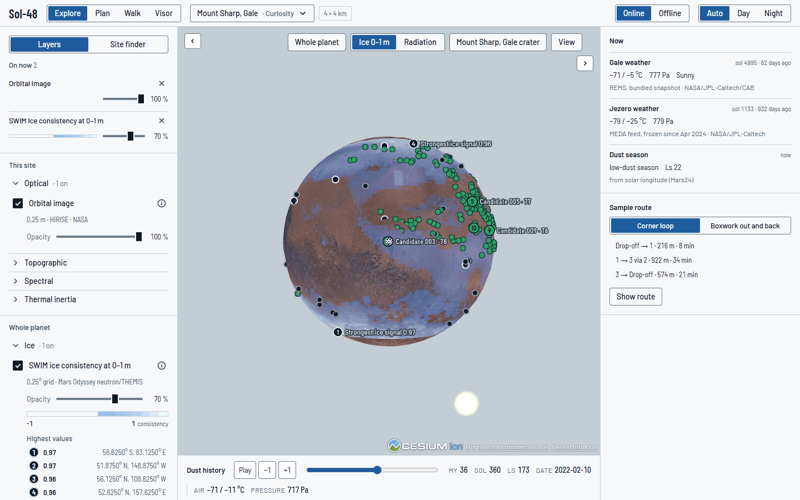
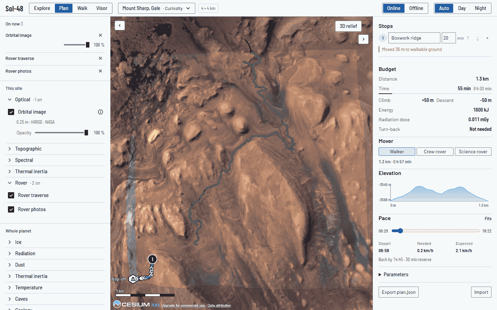
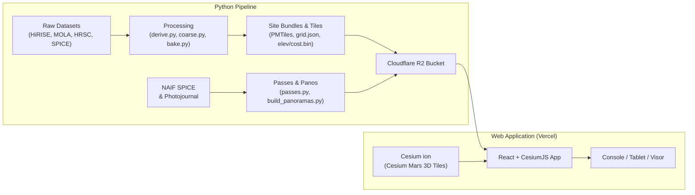

# Sol-48

Sol-48 is a walk-scale extravehicular activity (EVA) planning and rehearsal tool for Mars, built for the NASA Space Apps Challenge 2026. Working over 1-metre digital elevation models, an astronaut or mission planner stacks planetary and site-level orbital datasets (elevation, slope, thermal inertia, mineralogy, surface radiation, and dust history), sequences science stops, and computes obstacle-avoiding traverses. Each route is evaluated against physical and physiological budgets—distance, time, elevation change, metabolic energy expenditure, and surface radiation dose—with an automated turn-back point to ensure a safe return to shelter. Planned traverses can be reviewed and rehearsed in a tablet view and an astronaut helmet-visor heads-up display.

Live application: https://sol48.vercel.app

## Screenshots





## What it does

- Four operational tabs:
  - **Explore**: Interactive 3D Mars globe with planetary science overlays, landing site selection, current weather observations, and Mars Year 24–36 dust history.
  - **Plan**: Traverse planning over 1 m terrain with waypoint sequencing, dwell time adjustments, obstacle avoidance, and real-time budget calculations.
  - **Walk**: Rehearsal timeline simulating EVA execution with dual-walker tracking (EV1 and EV2 with positional uncertainty), trackside temperature curves, pace indicators, and daylight beeper alerts.
  - **Visor**: Eye-level helmet heads-up display providing warning ladder status, compass heading tape, next-stop distance and time countdown, remaining mission time, and emergency abort controls.
- Sites:
  - **Gale Crater (Mount Sharp)**: Primary 4 × 4 km site built from 1 m MRO HiRISE DEM and orthoimagery, aligned with Curiosity exploration routes.
  - **Jezero Crater (Delta)**: Secondary 4 × 4 km validation site built from 1 m MRO HiRISE DEM and orthoimagery, aligned with Perseverance traverses.
  - *Note*: McLaughlin crater is not included in `AVAILABLE_SITES` on `main` (only `gale` and `jezero` are configured in `app/src/config.ts`).
  - **Site Finder**: Evaluates and ranks candidate landing sites across Mars based on adjustable criteria weights (terrain slope and roughness, climate, solar energy, cave proximity, and radiation protection).
- Whole-planet layers:
  - Global map datasets including subsurface water ice (SWIM 0–1 m depth), surface radiation dose rate (MSL RAD), dust optical depth (Montabone MY24–MY36 climatology), cave candidates (MGC3), thermal inertia (TES night), mineral distributions (Bandfield TES olivine; MOCAAS hydrated clays, sulfates, and carbonates), regional geology (USGS SIM 3292), and diurnal surface temperatures (MRO MCS).
- Route planning and budgets:
  - Multi-stop pathfinding over a 2 m difficulty grid avoiding slopes steeper than 20° and impassable ground.
  - Calculated budgets: total distance, elapsed traverse time (against an 8-hour suit limit), cumulative climb and descent, metabolic energy expenditure, and absorbed radiation dose.
  - Automated turn-back computation indicating the latest point along the traverse from which returning to shelter remains feasible within consumable limits and safety reserves.
- Shelter:
  - Traverses start and finish at a designated Shelter (habitat or rover deployment base).
- Turn-by-turn and Sun directions:
  - Directional guidance with leg distances, waypoint bearings, Sun azimuth, elevation, and local solar time.
- Safety:
  - Warning ladder escalating through four levels: On pace, Behind pace, Turn back, and Return to shelter.
  - SOS emergency signaling with selectable reasons (Injury, Suit fault, Lost, Radiation), a 2-second hold-to-activate guard, and a 10-second cancel window.
  - Orbital communications passes predicting line-of-sight coverage windows for MRO and 2001 Mars Odyssey, with simulated signal transmission latency to Earth.
- Offline mode:
  - Toggle between online 3D terrain streaming (Cesium ion) and offline operation using bundled local raster tiles and elevation data for disconnected simulation.
- Guided tour:
  - Integrated interactive walkthrough highlighting interface controls, tab workflows, and planning tools.

## How it works

The system consists of an offline Python data pipeline that processes orbital datasets into baked map bundles and tiles served from a Cloudflare R2 bucket, and a client-side React and CesiumJS web application deployed to Vercel.



- **Energy model**:
  Walking metabolic power is computed using the Pandolf load-carriage equation for level and uphill traversal, combined with the Santee et al. (2003, USARIEM TN03-3) downhill correction factor for negative grades (capturing muscular eccentric braking during descents). Body and suit mass are scaled to Mars surface gravity (g = 3.71 m/s²). Standing and dwell intervals use a 1.5 MET baseline based on spacesuit metabolic rate sizing (Ogilvie et al., 2026).
  - Pandolf, K. B., Givoni, B., & Goldman, R. F. (1977). *Predicting energy expenditure with loads while standing or walking very slowly to moderate walking speeds.* Journal of Applied Physiology: Respiratory, Environmental and Exercise Physiology, 43(4), 577–581. doi:10.1152/jappl.1977.43.4.577.
  - Santee, W. R., Blanchard, L. A., Speckman, K. L., Gonzalez, J. A., & Wallace, R. F. (2003). *Load carriage model development and testing with field data.* USARIEM Technical Note TN03-3 (DTIC ADA415788); restated in Potter et al. (2013), Journal of Sport and Human Performance, 1(3), 34–42. doi:10.12922/jshp.0009.2013.
- **A\* route planning**:
  Traverse routing uses an A\* search over an 8-connected 2 m grid. Costs combine surface slope, roughness, and directional grade. Terrain steeper than 20° is flagged as impassable. If a stop falls on inaccessible ground, the planner snaps it to the nearest walkable ground and warns the user.
- **Sun times**:
  Solar coordinates and mission solar times are calculated using the NASA GISS Mars24 algorithm (Allison & McEwen, 2000; updated 2025). The algorithm computes Mars Sol Date (MSD), solar longitude (Ls), Local True Solar Time (LTST), Local Mean Solar Time (LMST), Sun azimuth and elevation, and sunrise/sunset crossings at solar zenith angle Z = 90°.

## Tools and frameworks

### App

| Name | Major version | Purpose | Verified against |
|---|---|---|---|
| React | 19 | UI framework and component state management | `app/package.json` |
| ReactDOM | 19 | Browser DOM rendering for React | `app/package.json` |
| CesiumJS (`cesium`) | 1.146 | 3D Mars globe, terrain rendering, and coordinate systems | `app/package.json` |
| PMTiles (`pmtiles`) | 4 | Reading cloud-native tile archives for raster and vector layers | `app/package.json` |
| Vite | 8 | Build tooling, dev server, and asset bundling | `app/package.json` |
| TypeScript | 5 | Static typing and data contracts | `app/package.json` |
| Vitest | 5 | Unit and integration testing | `app/package.json` |
| vite-plugin-static-copy | 4 | Build-time static asset distribution | `app/package.json` |
| Playwright | Headed browser | UI screenshot capture and visual verification | `docs/cesium/spike.md`, `app/package-lock.json` |

### Pipeline

| Library | Purpose | Verified against |
|---|---|---|
| `numpy` | Array operations, raster processing, and binary grid packing | `pipeline/requirements-ci.txt`, imported in `pipeline/*.py` |
| `scipy` | Scientific computation, interpolation, and NetCDF parsing | `pipeline/requirements-ci.txt`, imported in `pipeline/*.py` |
| `rasterio` | Geospatial raster I/O, DEM cropping, and slope/roughness calculations | Imported in `pipeline/derive.py`, `grids.py`, `coarse.py` |
| `geopandas` / `pandas` | Tabular data processing and rover pose coordinate transformations | Imported in `pipeline/mer_poses.py`, `features.py` |
| `shapefile` (`pyshp`) | Pure-Python ESRI Shapefile reader for SIM 3292 geology rasterisation | `docs/references.md`, imported in `pipeline/globe_geology.py` |
| `pmtiles` | Python utility for packing map tiles into PMTiles archives | Imported in `pipeline/bake.py` |
| `mercantile` | Spherical Mercator tile coordinate and bounding box math | Imported in `pipeline/basemap.py`, `bake.py` |
| `Pillow` (`PIL`) | Image processing, texture resizing, and panorama padding | `pipeline/requirements-ci.txt`, imported in `pipeline/build_panoramas.py` |
| `spiceypy` | Python wrapper for CSPICE toolkit; computes orbiter passes from NAIF kernels | `pipeline/requirements-ci.txt`, imported in `pipeline/passes.py` |
| `scikit-learn` (`sklearn`) / `joblib` | Machine learning model evaluation, ROC AUC metrics, and artifact storage | Imported in `pipeline/eval_walkability.py`, `walkability.py` |
| `lightgbm` | Gradient-boosted decision trees for experimental walkability classification | Imported in `pipeline/train_walkability.py` |
| `matplotlib` | Trajectory and diagnostic elevation profile plotting | Imported in `pipeline/passes.py`, `features.py` |
| `PyYAML` (`yaml`) | Site definition and pipeline configuration parsing | Imported in `pipeline/bake.py`, `common.py` |
| `pytest` | Test runner for pipeline data processing functions | Imported in `pipeline/test_*.py` |

*(Note: `boto3` is not used in the codebase; Cloudflare R2 uploads are handled via Wrangler CLI in `pipeline/upload_r2.py`.)*

### Data and services

| Platform / Service | Role |
|---|---|
| Cesium ion | Streams global 3D Mars terrain (Cesium Mars 3D Tiles, asset 3644333) |
| Cloudflare R2 | Object storage CDN hosting site bundles, PMTiles, route grids, pass schedules, and 360° panoramas |
| Vercel | Production static application hosting with automatic deployment on pushes to `main` |
| GitHub Actions | Automated CI workflows: identity checks (`identity-guard.yml`), scheduled daily data refresh (`refresh-data.yml`), and fallback manual deployments (`deploy-pages.yml`) |

### AI assistance

| System | Role |
|---|---|
| Claude, Codex, Gemini | AI coding assistants used to draft and review code and documentation, directed and reviewed by the team |

## Data sources

| Dataset | Mission / Source | Usage | Licence / Credit |
|---|---|---|---|
| HiRISE DTMs and Orthoimages | MRO HiRISE (USGS / NASA PDS) | Metre-scale elevation, slope, roughness, and visual base mosaics for Gale and Jezero | Public domain (US Government work) |
| CTX Images and DEMs | MRO CTX (USGS / NASA PDS) | Regional context imagery and topography | Public domain (US Government work) |
| MOLA–HRSC Blended Global DEM | NASA MRO / ESA Mars Express | Global elevation and base topography | MOLA: Public domain; HRSC: CC BY-SA 3.0 IGO |
| THEMIS Quantitative Thermal Inertia | Mars Odyssey THEMIS (USGS / NASA) | Regional 100 m surface thermal inertia | Public domain (US Government work) |
| CRISM Spectral Products | MRO CRISM (NASA PDS) | Surface mineral index layers | Public domain (US Government work) |
| MCS Surface Temperature | MRO Mars Climate Sounder (NASA PDS) | Global surface temperature climatology across solar longitudes (Level 5 DDR V6.2) | Public domain (US Government work) |
| SPICE Ephemerides | NASA NAIF / ESA SPICE Service | Spacecraft orbit kernels for MRO, Odyssey, TGO, and Mars Express pass predictions | Public domain / Open access |
| Rover Raw Photos | MSL Curiosity & M2020 Perseverance | Point-of-view stop photography and 360° Photojournal mosaics | Public domain; retain team credits |
| REMS and MEDA Weather | MSL Curiosity & M2020 Perseverance | Ground-level pressure, air temperature extrema, and UV conditions | Public domain; credit CAB (CSIC-INTA) & NASA/JPL |
| APXS Rock Chemistry | MSL Curiosity (NASA PDS / CSA) | In-situ rock oxide abundances at Gale science stops | Public domain; credit CSA & Univ. of Guelph |
| RAD Surface Dose | MSL Curiosity (NASA PDS / Zenodo) | Measured surface absorbed radiation dose and solar flare proxy rates | CC BY 4.0 (Heber & Löwe) |
| SWIM Subsurface Ice | SWIM Project (PSI / NASA) | Global subsurface water-ice consistency index (0–1 m depth) | Credited to Morgan & Putzig et al. (2025); removed on request |
| MOCAAS Hydrated Minerals | OMEGA / CRISM (IAS / PSUP) | Global aqueous alteration signatures (clays, sulfates, carbonates) | Credited to Carter et al. (2023); removed on request |
| Global Geologic Map | USGS Planetary Geologic Mapping Program | Global unit classifications and boundaries (Tanaka et al. 2014, SIM 3292) | Public domain |
| Montabone Dust Climatology | Mars Climate Database | Column dust optical depth across Mars Years 24–36 | CC BY-SA 3.0 |
| Cave Candidate Catalog | MGC3 (USGS / NASA PDS) | Global cave/pit candidate locations for shelter evaluation | Public domain |

For complete citations, download manifests, and licensing details, see [docs/references.md](docs/references.md).

## Run it locally

### Prerequisites

- Node.js 22 or newer
- Python 3.12 or newer (if running data pipeline scripts or tests)

### Application setup

```sh
cd app
npm ci
cp .env.example .env.local
```

Configure `app/.env.local`:
- `VITE_CESIUM_ION_TOKEN`: Cesium ion access token with permission for Cesium Mars 3D Tiles (asset 3644333). Without this token, the application operates in offline mode without 3D terrain elevation.
- `VITE_R2_BASE_URL`: Public URL of the Cloudflare R2 bucket. Leave empty in local development to load bundled assets from the Vite dev server.
- `VITE_TILES_BASE`: Base URL for tile bundles and site metadata (defaults to `/local-bundles` in development).
- `VITE_GLOBE_BASE`: Base URL for whole-planet layers (defaults to `/sample/globe`).

Start the development server:

```sh
npm run dev
```

### Running tests

```sh
# Frontend unit and integration tests (from app/ directory)
npx vitest run

# Pipeline tests (from repository root)
pytest
```

### Pipeline usage

The data pipeline processes raw orbital datasets into baked site bundles and passes. For full instructions on raw data preparation, DEM derivation, walkability model training, and R2 synchronization, see [docs/deploy.md](docs/deploy.md). Common pipeline commands:

```sh
python pipeline/fetch_spice.py --orbiters MRO,ODY
python pipeline/passes.py --orbiters MRO,ODY --days 30 --no-plot
python pipeline/build_panoramas.py
```

## Repository layout

| Path | Description |
|---|---|
| `app/` | Frontend web application (React 19, CesiumJS, TypeScript, Vite) |
| `app/src/` | App source code: UI components, Cesium views, route planner, physiological models |
| `app/public/` | Static web assets: icons, panoramas, fallback JSON fixtures, sample site data |
| `pipeline/` | Python data pipeline: DEM processing, tile baking, SPICE passes, panoramas |
| `docs/` | Project documentation, deployment guides, references, and research notes |
| `docs/tutorial/` | Step-by-step user guide and application screenshot assets |
| `docs/research/` | Research findings on EVA physiological limits, solar time math, radiation, and datasets |
| `docs/prd/` | Product requirements documents and contracts across development phases |
| `shared/` | Shared data tables, rover location poses, and coordinate lookups |
| `.github/workflows/` | GitHub Actions workflow definitions: identity verification, data refresh, and manual deploy |

## Team

Team: TBD

## Use of AI

AI coding assistants (Claude, Codex, Gemini) were used to write code and documentation in this repository, directed and reviewed by the team. Commits made with AI assistance carry a `Co-Authored-By` trailer in git history. No AI-generated images, video, or audio are used in this project.

## Licence

Licence: TBD
