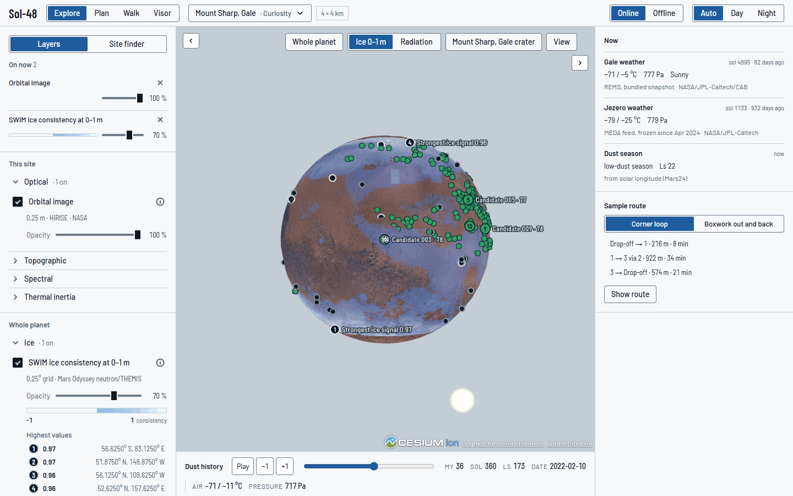
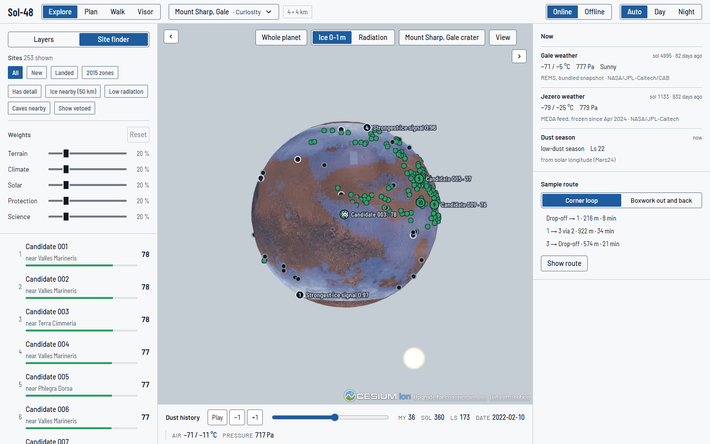
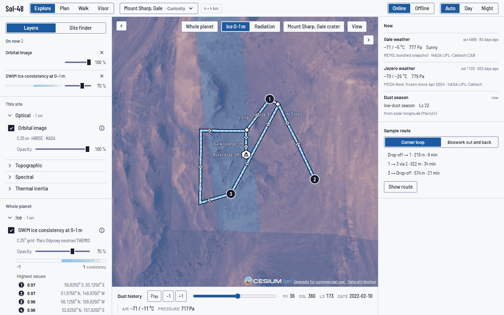
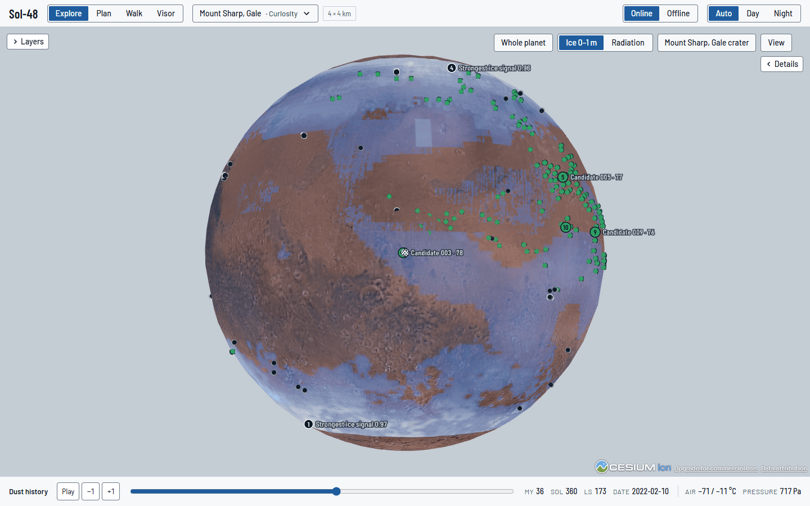
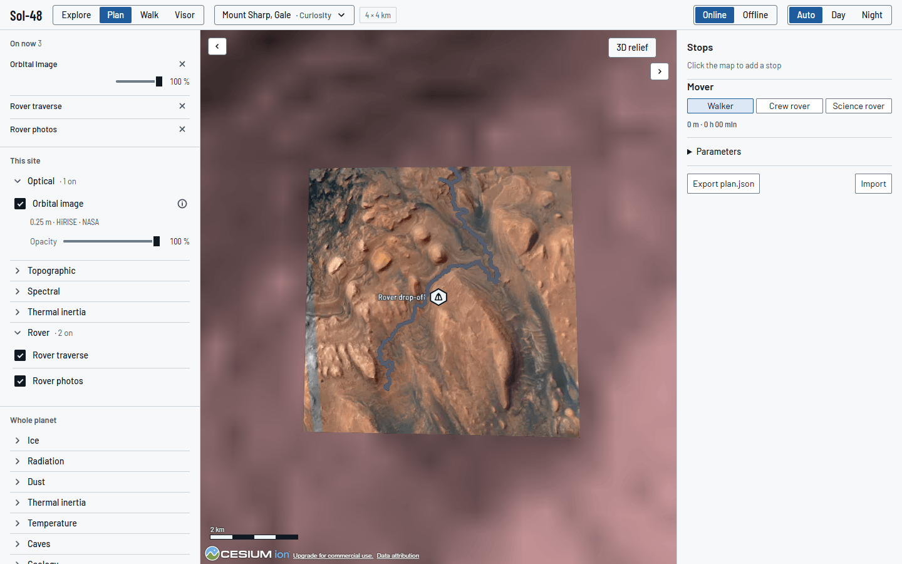
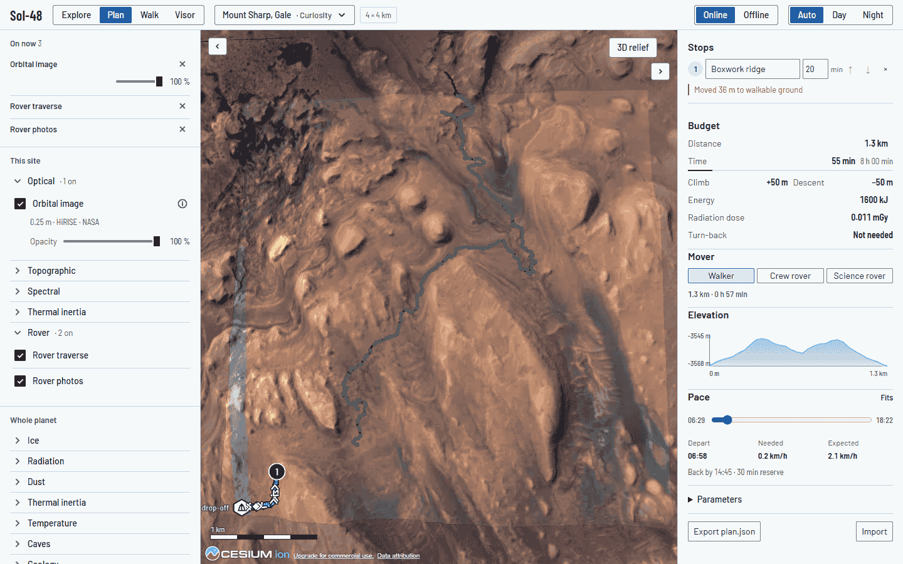
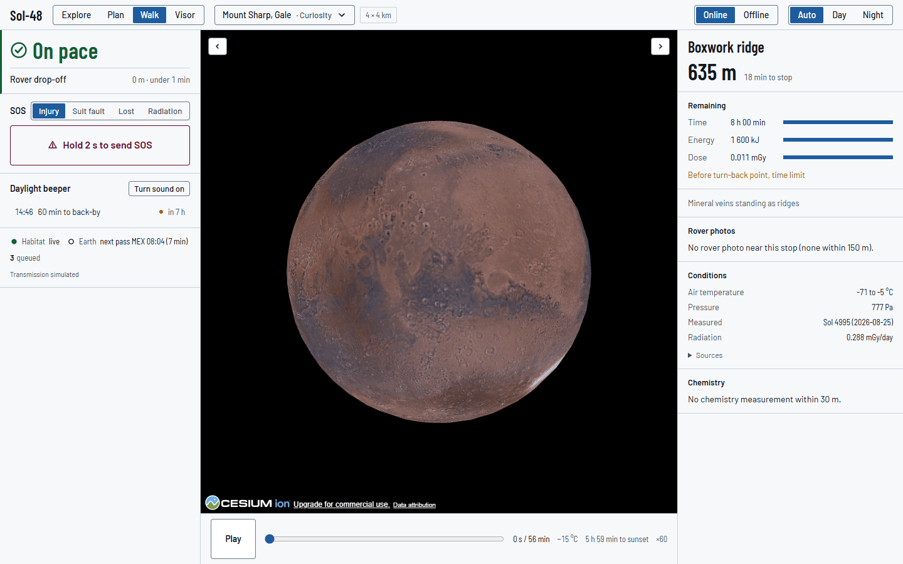
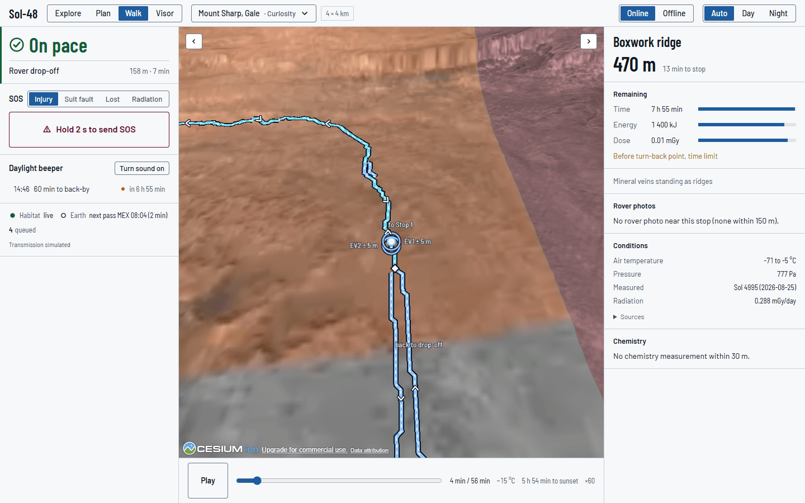
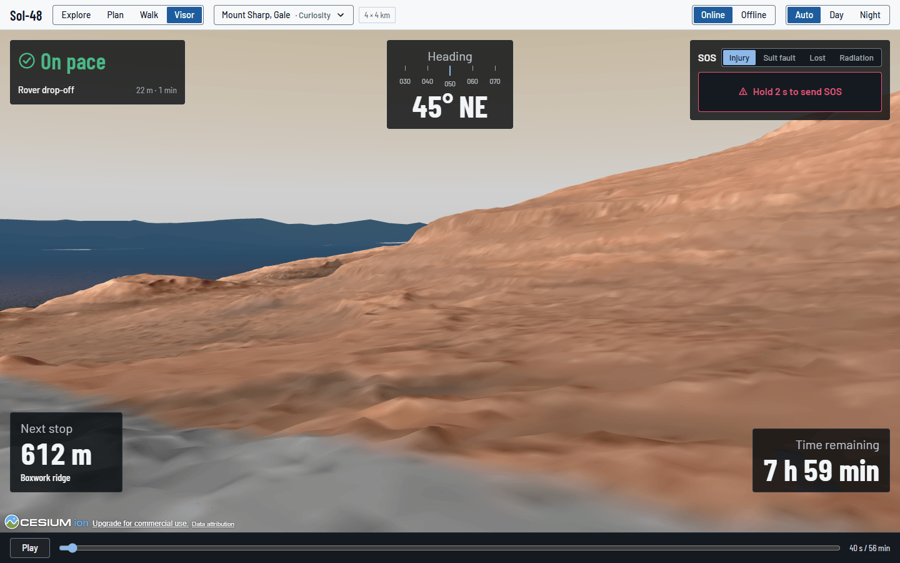

# Sol-48 tutorial

Sol-48 lets you plan a safe walk on Mars, then rehearse it. You study the site in **Explore**, build the route in **Plan**, replay it in **Walk** and see it as a helmet display in **Visor**.

Live app: https://sol48.vercel.app. Each tab has its own address: `?tab=explore`, `?tab=plan`, `?tab=walk`, `?tab=visor`. If the 3D globe does not load on your network, add `?offline=1` or press **Offline**.

The walk starts and ends at the **Shelter** (the Habitat by default). Screenshots taken before the rename show it as Rover drop-off.

- [60-second version for judges](#60-second-version-for-judges)
- [5-minute guided walkthrough](#5-minute-guided-walkthrough)
- [Screen reference](#screen-reference)

## 60-second version for judges

1. Open https://sol48.vercel.app. A Mars globe loads with water-ice and landing-site layers. The right panel shows current Gale weather and the dust season, each with its age.
2. In the right panel under **Sample route**, press **Show route**. The map flies into Mount Sharp, Gale crater and draws a loop from the **Shelter** through three stops.
3. Open **Plan**, click the map to add a stop. Read the **Budget**: distance, time, climb, energy, radiation dose and **Turn-back**. **Pace** shows whether the walk fits before sunset.
4. Open **Walk**, press **Play**. The walkers move along the route; the left panel shows **On pace**, the distance to the **Shelter**, the **SOS** control and the relay link to Earth.
5. Open **Visor**. The same walk as a helmet display: warning ladder, **Heading**, **Next stop**, **Time remaining** and **SOS**.

## 5-minute guided walkthrough

You need the sample plan file for step 8: download [`app/src/fixtures/plan.sample.json`](../app/src/fixtures/plan.sample.json) from this repository, or add stops by clicking the map instead.

### Explore (about 2 minutes)

1. **Open the app.** Go to https://sol48.vercel.app. Wait about 20 seconds for the globe. Look for: the green and dark site markers, the blue water-ice layer, and the **Dust history** bar under the map.
2. **Read the top bar.** Look for: the four tabs, the site picker **Mount Sharp, Gale · Curiosity**, the site size **4 × 4 km**, **Online** / **Offline** and **Auto** / **Day** / **Night**.
3. **Read current conditions.** In the right panel under **Now**, look for **Gale weather** (air temperature range, pressure, sol and how many days ago), **Jezero weather** and **Dust season** with its solar longitude (Ls).
4. **Stack a layer.** In the left panel under **Whole planet**, open **Radiation** and tick **Estimated surface radiation dose**. It appears under **On now** with an opacity slider and a × to remove it. Press the ⓘ next to any layer for its source.
5. **Find a site.** Switch the left panel to **Site finder**. Press **Low radiation**, then drag the **Protection** weight up. Look for: the ranked list reordering, each site with a score out of 100.

6. **Scrub the dust history.** In the **Dust history** bar, drag the slider or press **+1** to step one sol. Look for **MY** (Mars Year), **SOL**, **LS**, **DATE**, **AIR** and **PRESSURE** changing.
7. **Fly to the site.** Under **Sample route**, pick **Corner loop** and press **Show route**. Look for: the **Shelter** marker, stops 1 to 3, arrows for the walking direction, a fork marker where legs split, and each leg's distance and time listed in the panel.

Close both side panels with the ‹ and › handles on the map edges to see the whole map; reopen them with **Layers** and **Details**.

### Plan (about 1.5 minutes)

8. **Load a plan.** Open **Plan**. Wait until the site image appears, then press **Import** in the right panel and choose `plan.sample.json`. Or click the map to add your own stops.
9. **Check the stops.** Under **Stops**, look for **Boxwork ridge** with its dwell time in minutes, the ↑ ↓ buttons to reorder and × to remove. A note such as **Moved 36 m to walkable ground** means the planner shifted a stop off unsafe terrain.
10. **Read the budget.** Look for **Distance**, **Time** against the 8 h limit, **Climb** and **Descent**, **Energy**, **Radiation dose** and **Turn-back** (here **Not needed**).
11. **Check the pace.** Under **Pace**, drag the departure slider between sunrise and sunset. Look for **Depart**, **Needed** and **Expected** speed, the verdict (**Fits**) and **Back by** with its 30-minute reserve.
12. **Try another mover.** Press **Crew rover**, then **Walker** again. The route and the time line under **Mover** change with the mover's limits.

### Walk (about 1 minute)

13. **Start the rehearsal.** Open **Walk** and press **Play** in the bar under the map. Look for: two walkers (EV1 and EV2, each with a position uncertainty such as ± 5 m) moving along the route.
14. **Read the safety panel** on the left. Look for **On pace**, the distance and time back to the **Shelter**, the **SOS** reasons, the **Daylight beeper** schedule and the **Habitat** / **Earth** relay line with **Transmission simulated**.
15. **Read the stop panel** on the right. Look for the next stop's distance and minutes, **Remaining** **Time**, **Energy** and **Dose** bars, **Rover photos**, **Conditions** and **Chemistry** near the stop.
16. **Scrub.** Drag the walk slider or use the keys: Space plays or pauses, Left/Right steps 1 %, Page Up/Down jumps between stops. Look for the temperature and time to sunset in the bar updating.

### Visor (about 30 seconds)

17. **See it as a helmet display.** Open **Visor**. Look for the four readouts over the terrain: the warning ladder (top left), **Heading** (top centre), **Next stop** (bottom left), **Time remaining** (bottom right).
18. **Find SOS.** Top right: pick a reason, then hold **Hold 2 s to send SOS**. You then have 10 seconds to press **Cancel**. Release before 2 s to abort.

## Screen reference

Each area has three lines: what it is, how to use it, and why it matters for a Mars walk.

### Top bar

**Tabs: Explore, Plan, Walk, Visor**
- What: the four steps of the work, from studying the planet to walking the route.
- How: click a tab, or open a link ending `?tab=plan` and so on. Your plan carries across tabs.
- Why: the plan file built on Earth is the same one the crew carries and walks on Mars.

**Site picker (Mount Sharp, Gale · Curiosity)**
- What: the detailed sites, each a 4 × 4 km area with 1 m terrain: Mount Sharp, Gale and Jezero delta.
- How: click it and choose a site. The map, layers, weather and plan switch to that site.
- Why: a walk can only be planned safely where metre-scale terrain exists.

**Online / Offline**
- What: the map source. **Online** streams the 3D Mars globe; **Offline** uses the site's own bundled map and terrain.
- How: press either one. `?offline=1` in the address starts offline.
- Why: on Mars there is no streaming service; the tool must run from the local bundle.

**Auto / Day / Night**
- What: the colour theme.
- How: **Auto** follows your device; **Day** and **Night** force a light or dark look.
- Why: a dark, low-glare screen keeps night vision; a high-contrast light screen reads in daylight.

### Explore

**Left panel: Layers**
- What: science layers for this site and the whole planet, in groups such as **Ice**, **Radiation**, **Dust**, **Caves**, **Terrain**, **Site score**.
- How: open a group, tick a layer, set its opacity. **On now** lists active layers; × removes one; ⓘ shows the source.
- Why: water, radiation, dust and terrain decide where a crew can land, live and walk.

**Left panel: Site finder**
- What: ranked landing sites with a score out of 100, filter chips and weights.
- How: press chips such as **Low radiation** or **Caves nearby**; drag **Terrain**, **Climate**, **Solar**, **Protection**, **Science**; **Reset** restores equal weights.
- Why: it shows which sites pass the hard landing rules and why one ranks above another.

**Collapsing the side panels**
- What: the ‹ and › handles on the map edges.
- How: press a handle to close its panel; press **Layers** or **Details** on the map edge to reopen it.
- Why: more map in view when you study terrain or present.

**Map controls**
- What: **Whole planet**, the heatmap switch **Ice 0–1 m** / **Radiation**, **Mount Sharp, Gale crater** and **View**.
- How: **Whole planet** zooms out; the site button flies in; **View** turns on **Slopes** and **Lat/lon grid**.
- Why: you move between planet-scale choices and walk-scale detail without losing context.

**Right panel: Now**
- What: **Gale weather**, **Jezero weather** and **Dust season**, each with the sol and its age.
- How: read it; every value shows when it was measured and by which instrument.
- Why: old readings look like current ones unless their age is shown.

**Right panel: Sample route**
- What: two ready routes, **Corner loop** and **Boxwork out and back**, with each leg's distance and time.
- How: pick one and press **Show route** to fly to it.
- Why: a quick look at how a finished, safe route appears before you plan your own.

**Time bar: Dust history**
- What: a daily timeline of dust over Mars Years 24 to 36, with Gale weather for the date.
- How: press **Play**, **−1** / **+1** or drag the slider. Read **MY**, **SOL**, **LS**, **DATE**, **AIR**, **PRESSURE**.
- Why: dust storms cut power and visibility; their season tells you when to walk.

### Plan

**Left panel: Layers**
- What: the same layers as Explore, plus **Rover** (**Rover traverse**, **Rover photos**).
- How: tick layers to see slopes, walkability or minerals under your route. The ‹ handle closes it; **Layers** reopens it.
- Why: you see what the ground is like before you commit a stop there.

**Map**
- What: the site in 2D or 3D with your route, numbered stops, the **Shelter** and a scale bar.
- How: click to add a stop. **3D relief** tilts the terrain.
- Why: the route follows walkable ground and avoids slopes too steep for a suited walker.

**Right panel: Stops and Budget**
- What: the stop list and the walk's **Distance**, **Time**, **Climb**, **Descent**, **Energy**, **Radiation dose** and **Turn-back**.
- How: rename stops, set dwell minutes, reorder with ↑ ↓, remove with ×. The › handle closes it; **Plan** reopens it.
- Why: a walk is safe only if time, energy and dose stay inside the limits.

**Right panel: Mover, Elevation, Pace**
- What: **Walker**, **Crew rover** or **Science rover**; the height profile; departure time against sunrise and sunset.
- How: pick a mover; hover the profile; drag the departure slider and read **Needed**, **Expected** and **Back by**.
- Why: no night walking. The plan must end before sunset with a reserve.

**Right panel: Parameters, Export, Import**
- What: crew size, time limit, suit and body mass, stop dwell, energy limit, **Solar event**; the plan file.
- How: open **Parameters** to edit. **Export plan.json** saves the plan; **Import** loads one.
- Why: the plan file is the hand-over from Earth planning to the crew on Mars.

### Walk

**Left panel: Safety**
- What: the warning ladder (**On pace**, **Behind pace**, **Turn back**, **Return to shelter**) and the distance to the **Shelter**.
- How: read it while the walk plays; it escalates by itself. The ‹ handle closes the panel; **Safety** reopens it.
- Why: the crew learns early when to turn back, before daylight or suit time runs out.

**Left panel: SOS, Daylight beeper, relay**
- What: SOS with a reason, the countdown tones to the back-by time, and the **Habitat** and **Earth** links.
- How: press **Turn sound on** for the beeper. The relay line shows the next orbiter pass and items queued.
- Why: help comes from the habitat at once; Earth hears at the next orbiter pass.

**Right panel: Stop**
- What: the next stop's distance and time, **Remaining** **Time**, **Energy**, **Dose**, **Rover photos**, **Conditions**, **Chemistry**.
- How: read it as the walk advances. The › handle closes it; **Stop** on the map edge reopens it.
- Why: the crew knows what to sample at each stop and what budget is left.

**Map**
- What: the 3D terrain with the route, walking arrows and the two walkers, EV1 and EV2, with position uncertainty.
- How: drag to look around; the view follows the walkers during playback.
- Why: pair tracking shows if the two astronauts drift apart; the uncertainty widens hazard margins.

**Time bar: playback**
- What: **Play**, the walk slider, elapsed and total time, temperature, time to sunset and speed (×60).
- How: press **Play** or Space; Left/Right step 1 %; Page Up/Down jump between stops.
- Why: rehearsing the whole walk shows where the cold, the climbs and the turn-back point fall.

### Visor

**Warning ladder (top left)**
- What: the current warning level and the distance and time to the **Shelter**; hazards such as **Impassable 20 m ahead** appear below.
- How: glance at it; it changes colour and wording as the level rises.
- Why: one look tells the walker whether to continue, turn back or return to shelter.

**Heading (top centre)**
- What: a compass tape with the bearing in degrees and the direction (for example 45° NE).
- How: read it as you walk; the tape slides as your heading changes.
- Why: Mars has no global magnetic field, so a magnetic compass is unreliable; the display gives direction from the track.

**Next stop (bottom left)**
- What: the distance to the next stop and its name.
- How: read it; it counts down as you approach and switches at each stop.
- Why: the walker sees progress without opening a map.

**Time remaining (bottom right)**
- What: the time left in the walk's time limit.
- How: read it; compare it with the distance to the **Shelter** on the warning ladder.
- Why: suit time, oxygen and daylight are finite; this is the number that ends the walk.

**SOS (top right)**
- What: the emergency call with a reason: **Injury**, **Suit fault**, **Lost**, **Radiation**.
- How: pick a reason, hold **Hold 2 s to send SOS**; press **Cancel** within 10 seconds to stop it.
- Why: the hold and cancel window prevent false alarms; the habitat receives a sent SOS at once over the local link.

The playback bar under the Visor works as in **Walk**.
